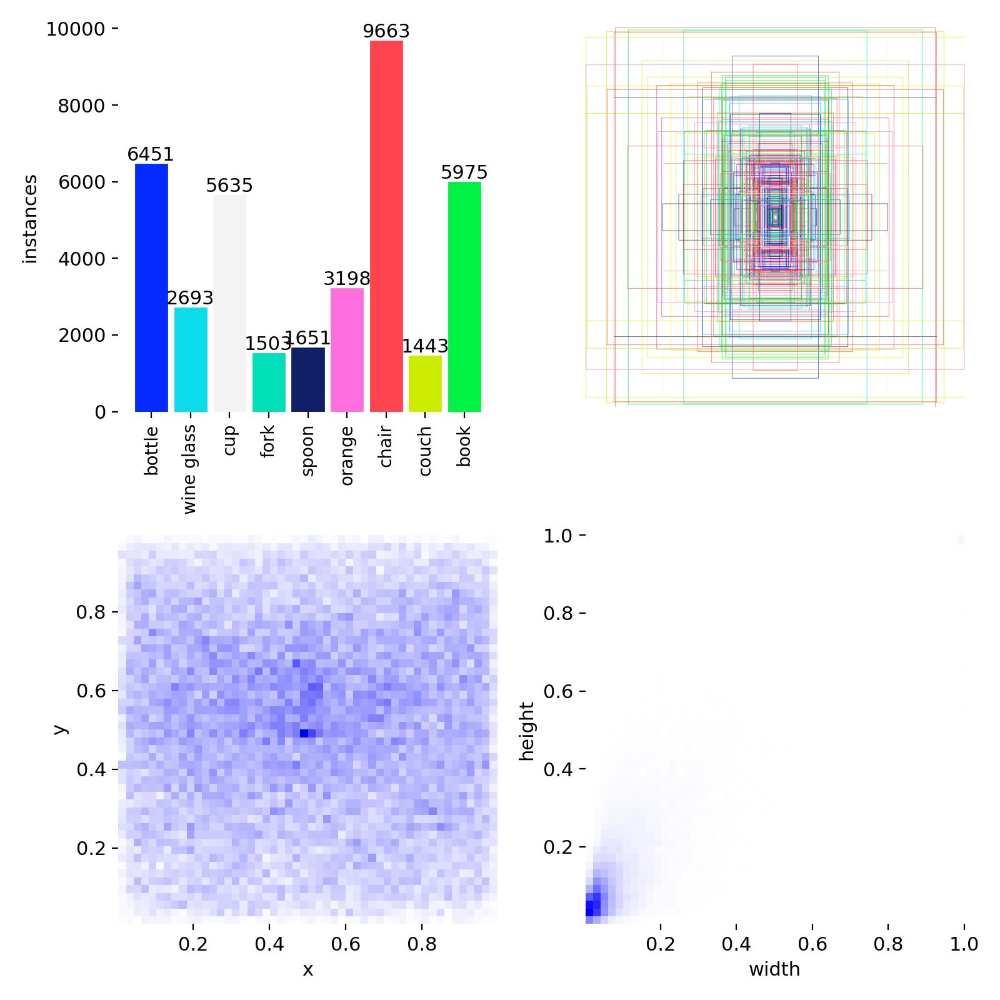
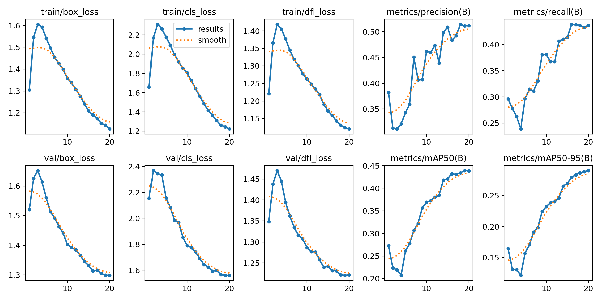
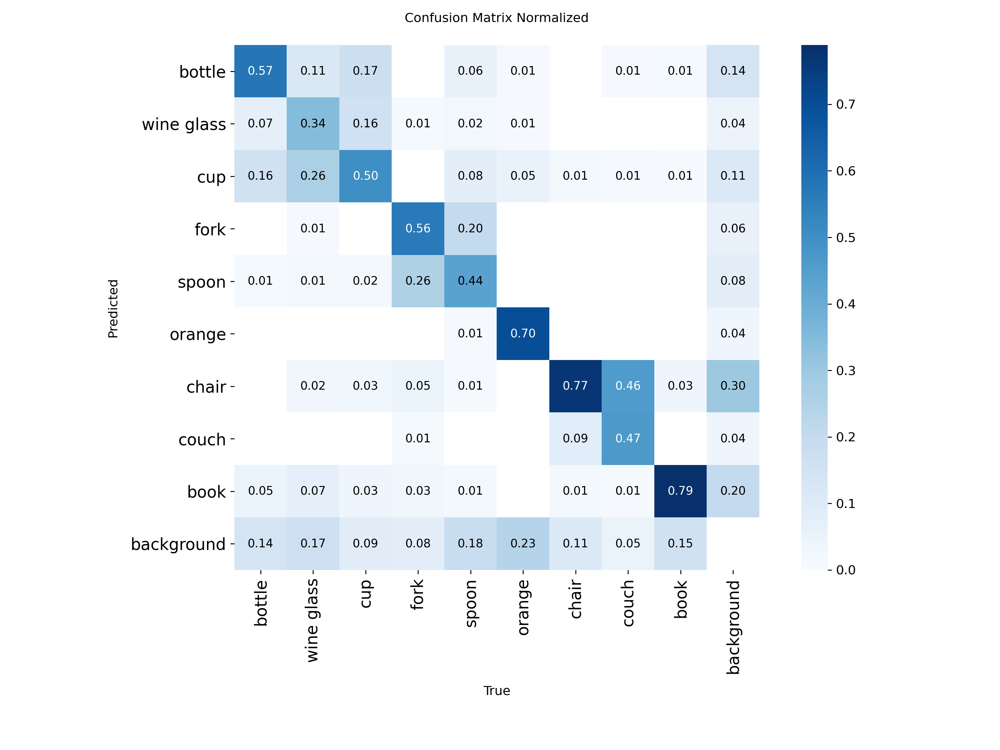
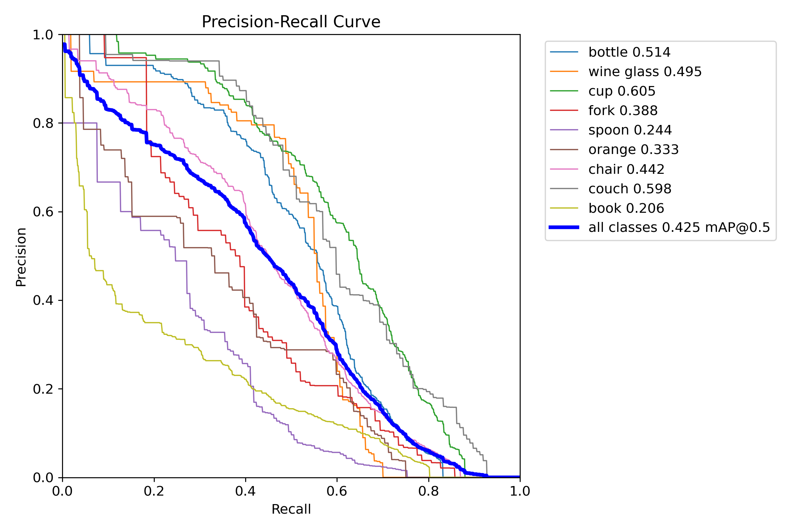
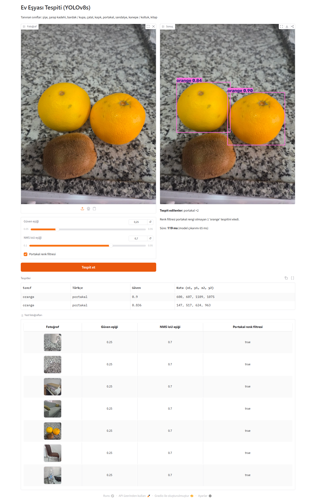
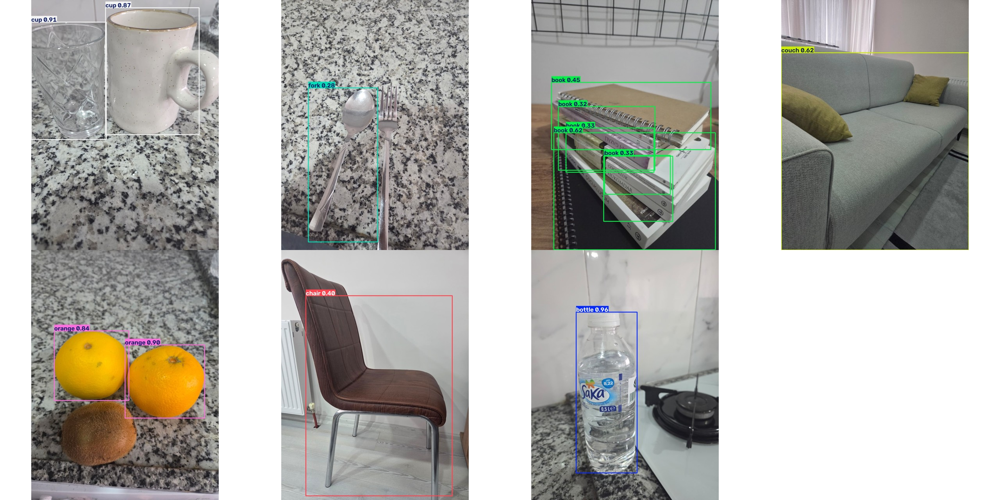

# Ev Eşyası Tespiti: YOLOv8s ile COCO 2017 Alt Kümesi Üzerinde Nesne Tespiti

**Ders:** Derin Öğrenme / Computer Vision Ödevi

**Öğrenci:** [Ad Soyad / Numara]

---

## 1. Proje Özeti

| Alan | Açıklama / Öğrenci yanıtı |
|---|---|
| **Project Title** | Ev Eşyası Tespiti: YOLOv8s ile COCO 2017 Alt Kümesi Üzerinde Nesne Tespiti |
| **Problem / Task** | Nesne tespiti (object detection): fotoğraftaki 9 ev eşyası sınıfının konumunu (sınırlayıcı kutu) ve sınıfını bulmak |
| **Dataset** | COCO 2017, 9 sınıflık alt küme: bottle, wine glass, cup, fork, spoon, orange, chair, couch, book. Train: 8800 görüntü (train2017; 800'ü etiketsiz negatif), Val: 679, Test: 679 (val2017 ikiye bölündü) |
| **Dataset URL** | https://cocodataset.org/#download |
| **Model Architecture** | YOLOv8s (Ultralytics), COCO üzerinde önceden eğitilmiş ağırlıklardan fine-tuning. CSPDarknet (C2f) omurga + PAN-FPN boyun + anchor-free ayrık başlık; 11,1 M parametre, 28,7 GFLOPs |
| **Input Size** | 640 × 640 × 3 (RGB, letterbox) |
| **Hyperparameters** | Epoch: 20, batch size: 16, lr0: 0.001 → 0.00001 (kosinüs), weight decay: 0.0005, warmup: 3 epoch (warmup_bias_lr = 0), AMP (FP16), seed: 42 |
| **Optimizer** | AdamW (β1 = 0.937, β2 = 0.999) |
| **Activation / Output Function** | Gizli katmanlarda SiLU; çıkışta sınıf skorları için sigmoid; kutu kenarları için DFL dağılımı; ardından NMS (IoU = 0.7) |
| **Loss Function** | 7.5 × CIoU (kutu) + 0.5 × BCE (sınıf) + 1.5 × DFL |
| **Evaluation Metrics** | Precision, Recall, F1-score, mAP@0.5, mAP@0.5:0.95, ortalama IoU, eğitim süresi, tahmin süresi |
| **Training Environment** | Dizüstü bilgisayar, NVIDIA GeForce RTX 4060 Laptop GPU (8 GB), PyTorch 2.6 + CUDA 12.4, Ultralytics 8.4, Python 3.10. Eğitim süresi: 59 dk 44 sn (bunun 16,5 dk'sı aşırı ısınmayı önlemek için verilen soğuma molaları) |
| **Best Performance** | Test kümesi: mAP@0.5 = 0.425, mAP@0.5:0.95 = 0.287, Precision = 0.521, Recall = 0.424, F1 = 0.468, ortalama IoU = 0.839. Telefon fotoğrafları: 7 fotoğrafın 6'sında tam başarı |
| **Inference Time** | GPU (RTX 4060): 12,8 ms/görüntü (≈ 78 FPS); CPU: 130 ms/görüntü |
| **Deployment Technology** | Gradio 6 (fotoğraf yükleme, kamera, eşik ayarı, renk filtresi seçeneği) |
| **Repository** | [GitHub linki] |

---

## 2. Görev

Amaç, ev ortamındaki gündelik nesneleri fotoğraf üzerinde bulan bir nesne tespit modeli
geliştirmektir. Model her nesne için bir sınırlayıcı kutu, sınıf etiketi ve güven skoru üretir.
Sınıflandırmadan farklı olarak aynı fotoğraftaki birden fazla nesneyi de ayrı ayrı bulabilir;
örneğin kaşık ile çatalı ya da iki portakalı.

## 3. Veri Seti

**COCO 2017**, 80 sınıflı ve 118 bin eğitim görüntüsü içeren açık kaynaklı bir nesne tespit veri
setidir. Bu çalışmada yalnızca 9 ev eşyası sınıfı kullanıldı (`prepare_coco_subset.py`).

| Sınıf | Türkçe | Train örnek | Val örnek | Test örnek |
|---|---|---|---|---|
| bottle | şişe | 6451 | 546 | 467 |
| wine glass | şarap kadehi | 2693 | 181 | 160 |
| cup | bardak / kupa | 5635 | 398 | 497 |
| fork | çatal | 1503 | 117 | 98 |
| spoon | kaşık | 1651 | 95 | 158 |
| orange | portakal | 3198 | 153 | 132 |
| chair | sandalye | 9663 | 915 | 856 |
| couch | kanepe | 1443 | 124 | 137 |
| book | kitap | 5975 | 579 | 550 |
| **Görüntü sayısı** | | **8800** | **679** | **679** |

**Hazırlık adımları:**
1. COCO anotasyonları indirildi. 9 sınıftan en az birini içeren görüntüler seçildi.
   Kalabalık (`iscrowd`) anotasyonları ve 1 pikselden küçük kutular atıldı.
2. COCO kutu formatı `[x, y, w, h]` (piksel), YOLO formatına `[sınıf, cx, cy, w, h]` (0–1 arası) çevrildi.
3. Eğitim süresini sınırlamak için train2017'den 8000 görüntü seçildi. Seçim **sınıf başına kota**
   ile yapıldı; her sınıf için en az 888 görüntü alındı. İlk denemede nadir sınıflara öncelik
   veren basit bir yöntem kullanılmıştı. O yöntem mutfak sahnelerini öne çıkardığı için kanepe
   sınıfında yalnızca 498 örnek kalmıştı; kota yöntemiyle bu sayı 1443'e çıktı.
4. **Zor negatifler:** Portakalla karışabilecek nesneler (elma, muz, havuç, brokoli, donut, top,
   pasta) içeren ama 9 sınıfımızdan hiçbirini içermeyen 800 görüntü, etiketsiz arka plan olarak
   eğitime eklendi.

**Train / Val / Test ayrımı:** Train görüntüleri COCO train2017'den alındı. Val ve test kümeleri,
val2017 alt kümesi rastgele ikiye bölünerek oluşturuldu. Bunun nedeni şu: Önceden eğitilmiş
YOLOv8 ağırlıkları train2017 ile eğitilmişti. Val/test kümelerini de train2017'den ayırsaydık,
model bu görüntüleri daha önce görmüş olurdu ve sonuçlar gerçekte olduğundan iyi çıkardı. Test
kümesi eğitim boyunca hiç kullanılmadı.

## 4. Model Mimarisi

**YOLOv8s** tek aşamalı (one-stage) bir nesne dedektörüdür:
- **Backbone (CSPDarknet, C2f + SPPF):** Görüntüden çok ölçekli özellik haritaları çıkarır.
- **Neck (PAN-FPN):** 8, 16 ve 32 adımlı (stride) özellikleri birleştirir. Böylece küçük nesneler
  (çatal, kaşık) ile büyük nesneler (kanepe) aynı modelde tespit edilebilir.
- **Head (anchor-free, ayrık):** Sınıflandırma ve kutu regresyonunu ayrı dallarda yapar. Kutu
  kenarları DFL ile bir olasılık dağılımı olarak tahmin edilir.

**Neden YOLOv8s?** Faster R-CNN gibi iki aşamalı modellerden çok daha hızlıdır ve gerçek zamanlı
bir web uygulamasına uygundur. "s" boyutu, laptop GPU'sunda makul eğitim süresi ile nano modelden
daha yüksek doğruluk arasında iyi bir denge sağlar.

**Fine-tuning:** Ağırlıklar `yolov8s.pt` dosyasından başlatıldı. 80 sınıflı çıkış katmanı 9
sınıflıyla değiştirildi ve hiçbir katman dondurulmadan tüm ağ eğitildi.

## 5. Model Ayarları ve Eğitim

| Parametre | Değer | Gerekçe |
|---|---|---|
| Girdi boyutu | 640 × 640 | Ön eğitimdeki çözünürlük; küçük nesneler için yeterli detay sağlar |
| Epoch | 20 | Laptopun ısınma sınırları nedeniyle 20 epoch ile sınırlandı (bkz. 5.1) |
| Batch size | 16 | 8 GB GPU belleğine AMP ile sığar |
| Öğrenme oranı | 0.001 → 0.00001 (kosinüs) | Önceden öğrenilmiş ağırlıkları bozmamak için düşük başlangıç değeri |
| Warmup | 3 epoch, `warmup_bias_lr = 0` | Ultralytics'in varsayılan bias ısınma oranı 0.1'dir; bu değer SGD için uygundur ama AdamW ile ön eğitimli ağırlıkları bozuyordu (bkz. 5.1) |
| Optimizer | AdamW | Adaptif öğrenme oranıyla fine-tuning'de hızlı yakınsar; ayrıştırılmış weight decay daha iyi düzenlileştirme sağlar |
| Weight decay | 0.0005 | Aşırı öğrenmeyi azaltır |
| Veri artırma | Mosaic, yatay çevirme, HSV, ölçek/öteleme; son 10 epochta mosaic kapalı | Farklı ışık, açı ve ölçeklere karşı dayanıklılık sağlar |
| AMP | Açık (FP16) | Eğitimi hızlandırır, bellek kullanımını düşürür |

**Aktivasyon / çıkış:** Gizli katmanlarda SiLU (x·σ(x)) kullanılır. Sınıf skorları sigmoid ile
[0, 1] aralığına getirilir; softmax yerine sigmoid kullanıldığı için her sınıf bağımsız puanlanır.
Son adımda NMS (IoU = 0.7) çakışan kutuları eler.

**Kayıp fonksiyonu:** CIoU kaybı kutunun örtüşmesine ek olarak merkez uzaklığını ve en-boy oranını
da cezalandırır. BCE her sınıf için ikili çapraz entropidir ve sigmoid çıkışıyla uyumludur. DFL,
kutu kenarlarının konumunu bir dağılım olarak öğrenerek sınırların daha keskin tahmin edilmesini sağlar.

### 5.1 Eğitim süreci ve karşılaşılan sorunlar

1. **AdamW + bias ısınması:** İlk denemede, ön eğitimli bir model için çok düşük olan mAP50 = 0.20
   değeri görüldü. Nedeni, Ultralytics'in ısınma sırasında bias parametrelerine verdiği 0.1 öğrenme
   oranıydı. `warmup_bias_lr = 0` ayarıyla ilk epoch değeri 0.29'a çıktı.
2. **Aşırı ısınma:** Laptop ilk eğitim denemesinde aşırı ısındı. `train.py`'ye bir sıcaklık koruması
   eklendi: Her 50 batch'te GPU sıcaklığı okunuyor; 80 °C aşılırsa eğitim 70 °C'ye inene kadar
   bekliyor. Bu korumayla GPU 67–80 °C aralığında kaldı ve toplam 16,5 dk mola verildi. Epoch sayısı
   da 30'dan 20'ye düşürüldü.

**Eğitim süresi:** 59 dk 44 sn (20 epoch, RTX 4060 Laptop, net hesaplama süresi yaklaşık 43 dk)

**Eğri yorumu:** İlk 3–4 epochta kayıplar yükseliyor ve mAP düşüyor. Bunun nedeni, 9 sınıflı yeni
çıkış katmanının rastgele başlaması ve ısınma sırasında öğrenme oranının artmasıdır. Sonrasında
eğitim ve doğrulama kayıpları birlikte düzenli olarak düşüyor; aşırı öğrenme (overfitting)
görülmüyor. Mosaic'in kapandığı 11. epochtan sonra mAP'de belirgin bir artış var. 20. epochta
doğrulama kaybı hâlâ düştüğü için **model tam yakınsamadı**; daha uzun eğitim sonucu iyileştirirdi.

## 6. Performans Değerlendirmesi (Test Kümesi, 679 görüntü)

### 6.1 Genel sonuçlar

| Metrik | Değer |
|---|---|
| mAP@0.5 | **0.425** |
| mAP@0.5:0.95 | **0.287** |
| Precision | 0.521 |
| Recall | 0.424 |
| F1-score | 0.468 |
| Ortalama IoU (conf ≥ 0.25, eşleşen kutular) | 0.839 |
| conf ≥ 0.25'te TP / FP / FN | 1247 / 1031 / 1808 |
| Tahmin süresi, GPU | 12,8 ms/görüntü (ön işleme 1,0 + çıkarım 10,4 + son işleme 1,4) |
| Tahmin süresi, CPU | 130 ms/görüntü |

**Metriklerin anlamı:**
- **IoU:** Tahmin kutusu ile gerçek kutunun kesişim alanının birleşim alanına oranı.
- **Precision:** Bulunan kutuların ne kadarının doğru olduğu; TP / (TP + FP).
- **Recall:** Gerçek nesnelerin ne kadarının bulunduğu; TP / (TP + FN).
- **F1:** Precision ve Recall'un harmonik ortalaması.
- **mAP@0.5:** IoU ≥ 0.5 olan tahminler doğru sayılarak her sınıf için hesaplanan Average Precision değerlerinin ortalaması.
- **mAP@0.5:0.95:** mAP'nin, IoU eşiği 0.5'ten 0.95'e kadar 0.05 adımlarla değiştirilerek alınan ortalaması (COCO'nun ana metriği).

### 6.2 Sınıf bazında sonuçlar

| Sınıf | Precision | Recall | F1 | mAP@0.5 | mAP@0.5:0.95 | Ort. IoU |
|---|---|---|---|---|---|---|
| bottle | 0.589 | 0.503 | 0.543 | 0.514 | 0.349 | 0.847 |
| wine glass | 0.623 | 0.537 | 0.577 | 0.495 | 0.340 | 0.847 |
| cup | 0.620 | 0.578 | 0.598 | **0.605** | **0.447** | 0.866 |
| fork | 0.503 | 0.378 | 0.431 | 0.388 | 0.260 | 0.839 |
| spoon | 0.488 | 0.260 | 0.339 | 0.244 | 0.130 | 0.805 |
| orange | 0.460 | 0.364 | 0.406 | 0.333 | 0.254 | 0.905 |
| chair | 0.505 | 0.449 | 0.475 | 0.442 | 0.276 | 0.818 |
| couch | 0.555 | 0.569 | 0.562 | 0.598 | 0.433 | 0.873 |
| book | 0.350 | 0.177 | 0.236 | **0.206** | **0.097** | 0.776 |
| **Tümü** | **0.521** | **0.424** | **0.468** | **0.425** | **0.287** | **0.839** |

**Yorum:**
- **En iyi sınıflar:** cup (0.605) ve couch (0.598). Bunlar belirgin şekilli ve genelde yeterince büyük görünen nesnelerdir.
- **En zor sınıflar:** book (0.206) ve spoon (0.244). Kitaplar raflarda çok sayıda, küçük ve üst üste
  durduğu için recall düşük kalıyor (0.177). Kaşıklar ince ve küçük nesneler; çok az piksel kaplıyorlar.
- **Sınıf karışıklıkları (karmaşıklık matrisi):**
    - Gerçek kanepelerin %46'sı chair olarak tahmin edilmiş. Koltuk ile sandalye görsel olarak yakın sınıflar.
    - Gerçek kadehlerin %26'sı cup sanılmış. Cam bardak ile kadeh arasındaki sınır COCO etiketlerinde de belirsiz.
    - Gerçek çatalların %26'sı spoon, gerçek kaşıkların %20'si fork olarak tahmin edilmiş. Metal, ince ve benzer şekilli nesneler.
- **Arka plan hataları:** Gerçek portakalların %23'ü hiç bulunamamış. COCO'da portakallar çoğunlukla
  meyve kâselerinde, küçük ve kalabalık gruplar halinde bulunuyor.
- **Ortalama IoU 0.84** yüksek bir değer: Model bir nesneyi bulduğunda kutuyu genelde doğru yerleştiriyor.
  Hataların çoğu kutu konumundan değil, nesnenin hiç bulunamamasından (recall) kaynaklanıyor.

### 6.3 Önceden eğitilmiş modelle karşılaştırma

Fine-tuning'in etkisini görmek için orijinal `yolov8s.pt` (80 sınıflı, fine-tune edilmemiş) aynı
test kümesinde yalnızca bu 9 sınıfla değerlendirildi:

| Model | mAP@0.5 | mAP@0.5:0.95 | Precision | Recall | F1 |
|---|---|---|---|---|---|
| Önceden eğitilmiş YOLOv8s (80 sınıf) | **0.488** | **0.340** | 0.575 | 0.449 | 0.504 |
| Bu çalışma (9 sınıf, 20 epoch fine-tune) | 0.425 | 0.287 | 0.521 | 0.424 | 0.468 |

Fine-tune edilen model, COCO test kümesinde orijinal modelin **6 puan gerisinde** kaldı. Nedenleri:
1. Orijinal model 118 bin görüntüde yaklaşık 500 epoch eğitildi. Bu çalışmada 8800 görüntü ve 20 epoch kullanıldı.
2. 9 sınıflı çıkış katmanı rastgele başlatıldı. Orijinal modelin bu sınıflar için öğrendiği çıkış ağırlıkları kullanılmadı.
3. Eğitim tam yakınsamadan durduruldu; doğrulama kaybı hâlâ düşüyordu.

Fine-tune edilen modelin kazanımları ise şunlar: Yalnızca 9 sınıf ürettiği için uygulamada alakasız
sınıf çıktısı vermiyor, eğitime portakal benzeri negatif örnekler eklendi ve telefon fotoğraflarında
7'de 6 başarı elde etti (bkz. Bölüm 8). Bölüm 9'da bu açığı kapatmak için öneriler yer alıyor.

## 7. Uygulama (Deployment)

Model **Gradio** ile web uygulamasına dönüştürüldü (`app.py`):
- Kullanıcı fotoğraf yükleyebilir, kamerayla çekebilir veya panodan yapıştırabilir.
- Güven eşiği ve NMS IoU eşiği kaydırıcılarla ayarlanır; portakal renk filtresi açılıp kapatılabilir.
- Çıktı olarak kutuları çizilmiş görüntü, tespit tablosu (sınıf, Türkçe adı, güven, koordinat) ve süre gösterilir.
- Telefonla çekilen 7 test fotoğrafı hazır örnek olarak sunulur.

Çalıştırma: `python app.py` → http://127.0.0.1:7860

## 8. Gerçek Görüntülerle Test (Telefon Fotoğrafları)

Telefonla 7 fotoğraf çekildi ve modele verildi (güven eşiği 0.25, `predict_test_photos.py`).

| # | Fotoğraf | İçerik | Beklenen | Model tahmini (güven) | Sonuç |
|---|---|---|---|---|---|
| 1 | sise.jpg | Şeffaf plastik su şişesi | bottle | bottle (0.96) | ✅ Başarılı |
| 2 | kasik_catal.jpg | Granit tezgâhta metal kaşık ve çatal | spoon, fork | Kaşık **fork (0.28)** olarak etiketlendi; çatal bulunamadı | ❌ Başarısız |
| 3 | meyveler.jpg | 2 portakal + 1 kivi | orange ×2 | orange (0.90), orange (0.84); kivi renk filtresiyle elendi | ✅ Başarılı |
| 4 | kitaplar.jpg | Üst üste kitaplar ve defterler | book (birden fazla) | book ×6 (0.27–0.62) | ✅ Başarılı |
| 5 | bardak_kupa.jpg | Cam bardak + seramik kupa | cup ×2 | cup (0.91), cup (0.87) | ✅ Başarılı |
| 6 | sandalye.jpg | Deri, krom ayaklı sandalye | chair | chair (0.40) | ✅ Başarılı |
| 7 | koltuk.jpg | Gri kumaş kanepe, yeşil yastıklar | couch | couch (0.62) | ✅ Başarılı |

**Sonuç: 7 fotoğrafın 6'sında tam başarı.** Telefon fotoğraflarında tahmin süresi GPU'da görüntü başına yaklaşık 10–13 ms.

### 8.1 Fotoğraf bazında yorum

1. **sise.jpg: Başarılı (0.96).** Şeffaf nesneler zor sayılsa da bu şişenin etiketi, mavi kapağı ve
   tipik şekli belirgin. Model şişeyi en yüksek güvenle buldu ve kutuyu şişenin tamamına oturttu.
2. **kasik_catal.jpg: Başarısız.** Model kaşığın etrafına bir kutu çizdi ama onu **fork** olarak
   etiketledi (0.28). Gerçek çatalı ise yalnızca 0.16 güvenle buldu; bu değer eşiğin altında kaldı.
   Nedenler:
    - Desenli granit zemin metal nesnelerin kenarlarını kamufle ediyor.
    - Yansıtıcı metal yüzeylerin dokusu yok.
    - Nesneler ince ve uzun; ayırt edici kısımları (kaşığın çukuru, çatalın dişleri) çok küçük.
    - Karmaşıklık matrisi de test kümesinde fork ile spoon'un %20–26 oranında karıştığını gösteriyor.
      Bu fotoğraftaki hata, modelin genel zayıflığıyla tutarlı.
3. **meyveler.jpg: Başarılı, ancak renk filtresi sayesinde.** Model iki portakalı 0.90 ve 0.84
   güvenle buldu. **Kiviyi de 0.84 güvenle "orange" sandı.** COCO'da kivi sınıfı yok; model yalnızca
   bildiği 9 sınıftan birini seçebiliyor (kapalı küme, closed-set varsayımı). Yuvarlak bir meyve
   olduğu için en yakın sınıfı portakal olarak seçti. Eğitime eklenen 800 negatif görüntü bu hatayı
   tek başına önleyemedi. Bu nedenle `postprocess.py` içine bir **renk doğrulaması** eklendi:
   "orange" kutusunun merkezindeki piksellerin en az %40'ı turuncu–sarı tonunda (H 10–65°, S ≥ 0.5,
   V ≥ 0.5) değilse tespit eleniyor. Portakallarda bu oran 1.00, kivide 0.15 çıktı. Filtrenin COCO
   test kümesindeki bedeli: Portakal recall'u 0.318'den 0.288'e düştü (132 portakaldan yaklaşık 4'ü
   kayboldu), precision ise değişmedi (0.424 → 0.427). Gölgede kalan veya soluk renkli portakallar
   filtreye takılabiliyor. Bu bir sınırlamadır ve filtre uygulamada isteğe bağlı bırakıldı.
4. **kitaplar.jpg: Başarılı.** Model 6 kitap/defter buldu. Güven skorları düşük (0.27–0.62): Üst üste
   duran kitaplarda yalnızca ince kenarlar görünüyor ve kutular iç içe geçiyor. En alttaki spiralli
   defter ile en üstteki defter de "book" olarak bulundu; bu, COCO'nun etiketleme mantığıyla uyumlu.
   Test kümesinde book recall'unun düşük olması (0.177) düşünülürse bu iyi bir sonuç.
5. **bardak_kupa.jpg: Başarılı.** Cam bardağın "wine glass" ile karışması bekleniyordu. Ancak model
   ikisini de doğru şekilde **cup** olarak buldu (0.91 ve 0.87). Bardağın ayaksız, düz tabanlı şekli
   kadehten ayırt edilmesini sağladı.
6. **sandalye.jpg: Başarılı, düşük güvenle (0.40).** Kutu doğru yerde. Güvenin düşük olmasının nedeni
   muhtemelen deri kaplamalı, geniş oturağın kanepeye benzemesi. Test kümesinde chair ile couch'un
   sık karıştığı görülmüştü.
7. **koltuk.jpg: Başarılı (0.62).** Kanepe kadrajın büyük kısmını kaplıyor ve kısmen kadraj dışında
   kalıyor. Model tek bir couch kutusu çizdi. Yastıklar ayrı bir sınıf olmadığı için ek kutu oluşmadı.

### 8.2 Genel değerlendirme

**Başarılı olduğu durumlar:**
- Büyük, belirgin şekilli ve iyi aydınlatılmış nesneler: şişe, kupa, kanepe.
- Kadraja tek başına yerleştirilmiş nesneler. Telefon fotoğrafları tek nesneye odaklandığı için
  bu fotoğraflardaki başarı (6/7), COCO test kümesindeki kalabalık sahnelere göre daha yüksek.

**Başarısız olduğu durumlar:**
- İnce, küçük ve yansıtıcı nesneler (kaşık, çatal), özellikle desenli bir zemin üzerindeyken.
- Veri setinde olmayan nesneler (kivi). Model "bilmiyorum" diyemiyor; en yakın sınıfı seçiyor.
  Bu fotoğrafta sorun, kural tabanlı bir renk filtresiyle çözüldü.
- Benzer sınıf çiftleri (sandalye–kanepe, kaşık–çatal): Doğru sonuçlarda bile güven skorları düşük kalıyor.

## 9. Sonuç ve Geliştirme Önerileri

Bu çalışmada COCO 2017'nin 9 ev eşyası sınıfı üzerinde YOLOv8s fine-tune edildi:
- Test kümesinde mAP@0.5 = 0.425, mAP@0.5:0.95 = 0.287 elde edildi.
- Model GPU'da görüntü başına 12,8 ms ile gerçek zamanlı çalışıyor ve Gradio ile kullanılabilir bir uygulamaya dönüştürüldü.
- Telefon fotoğraflarında 7'de 6 başarı sağlandı.
- Veri setinde olmayan kivinin portakal sanılması, renk doğrulamasıyla önlendi.

Fine-tune edilen model COCO test kümesinde orijinal ön eğitimli modelin gerisinde kaldı. Bu açığı
kapatmak için:
1. **Çıkış katmanını ön eğitimli ağırlıklarla başlatmak:** 80 sınıflı modelin bu 9 sınıfa ait çıkış ağırlıklarını kopyalamak. Böylece eğitim 0.49 mAP'den başlar, sıfırdan değil.
2. **Daha uzun eğitim:** 20 epochta doğrulama kaybı hâlâ düşüyordu. GPU'su daha güçlü bir ortamda (ör. Colab) 50+ epoch denenebilir.
3. **Omurgayı dondurmak** (`freeze=10`) ve daha düşük öğrenme oranı (1e-4) kullanmak; ön eğitimde öğrenilen özellikler daha iyi korunur.
4. **Daha fazla veri:** train2017'deki tüm uygun görüntüleri (~30 bin) kullanmak.
5. **Daha yüksek çözünürlük** (ör. 960 piksel): Küçük nesnelerde (kaşık, çatal, kitap) iyileşme sağlayabilir.
6. **Açık küme tespiti:** Kivi gibi bilinmeyen nesneler için kural tabanlı filtre yerine bilinmeyen nesneleri reddedebilen yöntemler veya kivi içeren ek veri.

## Kaynaklar

- Lin, T.-Y. et al. (2014). *Microsoft COCO: Common Objects in Context.* ECCV.
- Jocher, G., Chaurasia, A., Qiu, J. (2023). *Ultralytics YOLOv8.* https://github.com/ultralytics/ultralytics
- Zheng, Z. et al. (2020). *Distance-IoU Loss: Faster and Better Learning for Bounding Box Regression.* AAAI.
- Li, X. et al. (2020). *Generalized Focal Loss.* NeurIPS.
- Loshchilov, I., Hutter, F. (2019). *Decoupled Weight Decay Regularization (AdamW).* ICLR.
- Gradio: https://www.gradio.app
