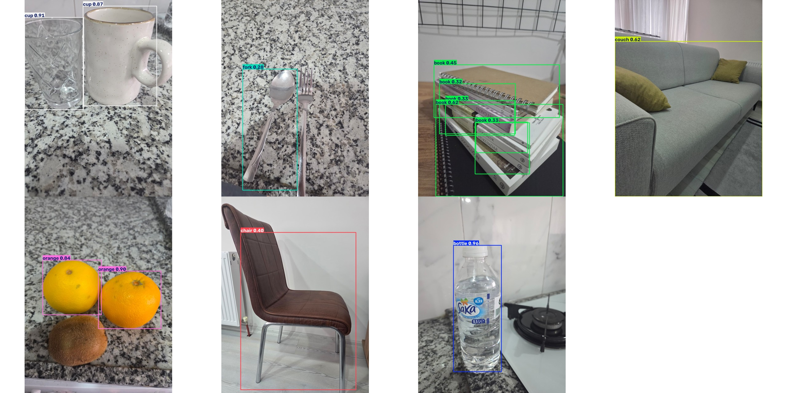

# Ev Eşyası Tespiti: YOLOv8s + COCO 2017

COCO 2017'nin 9 ev eşyası sınıfında (bottle, wine glass, cup, fork, spoon, orange, chair, couch, book)
YOLOv8s ile nesne tespiti. Rapor: [RAPOR.pdf](RAPOR.pdf) / [RAPOR.md](RAPOR.md)

**Sonuçlar (test kümesi):** mAP@0.5 = 0.425, mAP@0.5:0.95 = 0.287, F1 = 0.468.
GPU'da 12,8 ms/görüntü. Telefon fotoğraflarında 7'de 6 başarı.



## Dosyalar

| Dosya | Görev |
|---|---|
| `prepare_coco_subset.py` | COCO'dan 9 sınıflık YOLO veri setini hazırlar (train/val/test) |
| `train.py` | YOLOv8s fine-tuning (laptop için isteğe bağlı sıcaklık koruması) |
| `evaluate.py` | Test metrikleri ve tahmin süresi |
| `predict_test_photos.py` | Telefon fotoğraflarıyla test |
| `postprocess.py` | Portakal renk filtresi (kivinin portakal sanılmasını önler) |
| `app.py` | Gradio uygulaması |
| `weights/best.pt` | Eğitilmiş model |
| `results/` | Metrikler, grafikler, test fotoğrafı çıktıları |

## Çalıştırma

```bash
pip install -r requirements.txt
python app.py          # http://127.0.0.1:7860
```

Modeli yeniden eğitmek için:

```bash
python prepare_coco_subset.py --out DATA_KLASORU
python train.py --data DATA_KLASORU/coco9.yaml --workers 4 --max-temp 80
python evaluate.py --data DATA_KLASORU/coco9.yaml --cpu-timing 50
python predict_test_photos.py
```
